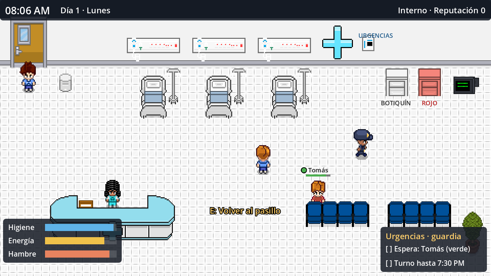
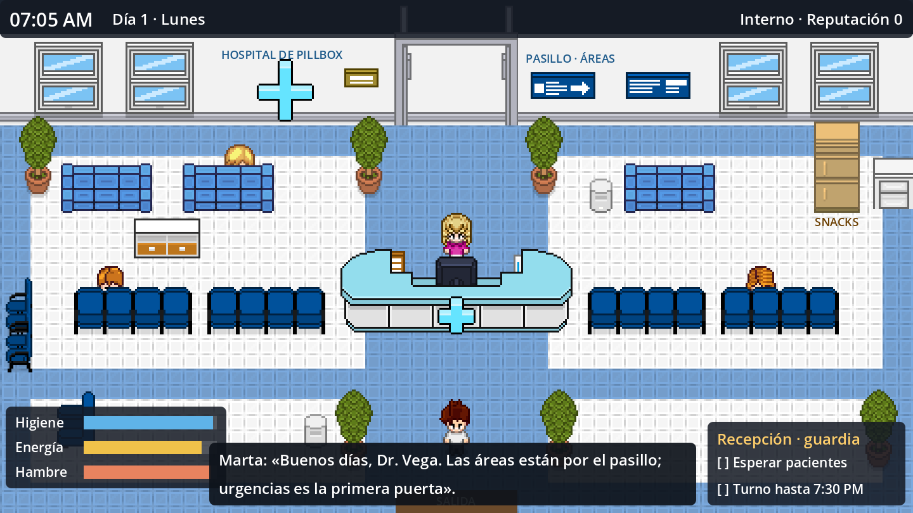

# Bata Blanca: Hospital de Pillbox

Juego 2D de vista cenital en **Godot 4.5** · Diseño Multimedia y Videojuegos · FESC.

El Dr. **Walter Pinkman** empieza como interno en el Hospital de Pillbox. Cada día se levanta en su casa, se prepara, trabaja su turno de 7:30 AM a 7:30 PM y vuelve a casa a descansar. Cómo cuide su rutina tiene consecuencias en el hospital.






## Cómo abrirlo

1. Instala **Godot 4.5** (versión estándar, no hace falta la de .NET).
2. En el Project Manager: **Importar** → selecciona `project.godot` de esta carpeta.
3. Pulsa **F5** (o el botón ▶) para jugar.

## Controles

| Tecla | Acción |
|---|---|
| WASD / flechas | Moverse |
| E o Espacio | Interactuar con lo que está cerca |
| 1-9 o clic | Elegir opción en los menús · Esc cancela |
| C | Abrir el celular (mensajes, tienda, banco) |
| Tab (mantener) | Acelerar el tiempo ×10 (para probar) |

## Versión 1: qué incluye

**El día de Walter**
- Reloj del juego: **1 segundo real = 1 minuto de juego** (un turno de 12 horas dura unos 12 minutos reales). Cada acción gasta tiempo (bañarse 15 min, desayuno 5 o 20 min, vestirse 10 min, viaje 20 min).
- **Mañana en casa:** bañarse, desayunar, ponerse la bata y salir. Checklist en pantalla.
- **Turno en el hospital** de 7:30 AM a 7:30 PM. Al terminar, vuelve solo a casa.
- **Noche en casa:** cenar, ponerse la pijama, poner la alarma y dormir. **Dormir guarda la partida.**

**Necesidades y consecuencias**
- **Higiene:** baja con el tiempo. Con higiene baja se ven olores verdes sobre Walter; si es muy baja, Lucía y los pacientes se quejan y baja la reputación.
- **Energía:** baja durante el día y se recupera durmiendo (menos sin pijama). Con poca energía Walter camina más lento.
- **Hambre:** sin desayunar o cenar baja rápido, y con hambre la energía cae el doble. En el hospital hay máquina de snacks.
- **Bata:** ir en pijama obliga a ir al vestidor del hospital (10 min, −3 reputación). Después de 3 turnos la bata se ensucia; se lava en la lavadora de la casa.
- **Alarma:** sin alarma, Walter se despierta entre 7:15 y 8:30. Llegar después de las 7:30 resta reputación; 5 días seguidos puntual suman.
- No ir al hospital antes del mediodía cuenta como falta (−15). Quedarse despierto hasta las 2:00 AM hace que Walter se duerma donde esté.

**Hospital** (varias salas conectadas)
- **Recepción** con Erina, sala de espera, sofás, plantas y máquina de snacks → **Pasillo** (sillas contra la pared, letreros y piso azul con paneles) con cinco puertas: **1 Urgencias**, **2 Vestidor** (casilleros con batas y ducha del personal), **3 Cafetería** (almuerzo y máquina de snacks), **4 Dirección** (el Dr. Salgado comenta tu reputación) y **5 Consultorios** (cerrado hasta ser Residente).
- Los pacientes siguen empeorando aunque Walter esté en otra sala; el altavoz lo llama a urgencias cuando llega alguien.
- Llega un paciente cada 40-70 minutos de juego (unos 12 por turno). Puede llegar un caso grave, más seguido desde el día 2.
- Ciclo: **el paciente cuenta qué le pasó → examinar con una herramienta (termómetro, estetoscopio, tensiómetro, otoscopio, linterna, glucómetro o palpar) → elegir diagnóstico → tomar el insumo del botiquín → aplicarlo**. Hay 19 casos base (de herida y fiebre a migraña, gastritis, faringitis, picadura de abeja, golpe en la cabeza, alergia grave, golpe de calor o infarto) más 6 de especialidad; en los graves el paciente no puede hablar y lo cuenta Lucía. Cada paciente da +3 de reputación (graves +6); con un error, solo +1.
- Si Walter no está seguro, puede **derivar** al paciente. Con 4 derivados en la semana, Salgado llama a Walter y a Noctis a la dirección. Lucía o el Dr. Brown orientan cuando Walter se equivoca, y Brown puede dar una pista (3 al día) o atender a un paciente (cuenta como derivado). Un diagnóstico errado baja la estabilidad; si llega a 0, el paciente se transfiere (−5).
- Lucía, en la enfermería de urgencias, da pistas sobre qué insumo usar.

**Eventos**
- **Hora pico:** un accidente trae varios pacientes seguidos.
- **Apagón:** el hospital se oscurece y los pacientes empeoran más rápido. Hay que avisar a Salgado para que llame al electricista **Paul Catelli**; tus consejos deciden si la luz vuelve a fallar y qué tan seguido se va.
- **El director llama por el megáfono** cada pocos días para hablar del rendimiento.
- **La ambulancia (ESC-02 del guion):** desde el día 2 suena el código rojo. Walter sale a la entrada, llega la ambulancia con sirena y **Cristian Daniel** baja a Andrés (24 años, alergia al maní) y lo lleva en camilla a urgencias. Si Lucía confía en Walter (amistad 3+), abre el botiquín rojo y vigila a los demás; si no, grita la clave del botiquín. La epinefrina es una sola dosis: si se desperdicia, Cristian corre por otra. Con Andrés crítico suena un latido. Salvarlo da +8 de reputación extra.
- **Eventos del día** (`scripts/eventos.gd`, uno al azar casi todos los días desde el día 2, más los de historia):
  - **Incendio en la cafetería:** humo en la cocina de Doña Luz; Walter habla con Lucía para evacuar la sala de espera y llegan los bomberos.
  - **Paciente que se escapa** por el pasillo: convencerlo o pedirle a McClane que lo detenga.
  - **Inspección sorpresa** de la Secretaría de Salud (higiene, bata limpia, espera y transferidos).
  - **Falta un insumo** del botiquín: Cristian lo trae de la farmacia o Brown lo presta (y queda debiendo un favor).
  - **Ascensor atascado** con el capitán Marcos Rojas adentro; llega Paul Catelli.
  - **Dakota trae a un detenido herido** y Zacarías se pone nervioso.
  - **Examen sorpresa del Dr. Brown** a Walter, Jinu y Wilder.
  - **Cumpleaños de Erina:** conseguir el pastel con Doña Luz, distraerla y la sorpresa a las 3 PM.
  - **Diego esconde el estetoscopio** de Walter (Sheyla sabe dónde está).
  - **Rhea Pawlak llega herida de verdad** y Reyes está muy nervioso.
  - **Accidente grande en la avenida:** dos ambulancias, patrulla y bomberos; llegan tres heridos.
  - **Ola de calor:** más golpes de calor, cafetería llena y jugos gratis.
  - **Mamá visita el hospital** con almuerzo (y les muestra a todos fotos de Walter de bebé).
  - **Llamada del arrendador** si Walter quedó en deuda con el arriendo.
- **Cafetería:** bebida energética (1 por turno: +15 % de energía y más velocidad por 1 minuto) y Doña Luz en la barra.

**Personas, diálogos y sonido**
- 20 NPC con nombre propio y diálogos (E para hablar). Todos caminan por su zona, menos las enfermeras de mostrador (Erina en recepción y Lucía en urgencias).
- Policías: **Alejandro Reyes** (entrada), **Jaiden Mendoza** (urgencias) y **John McClane** (pasillo). Médicos: **Dr. Maximiliano Brown** (urgencias), **Dr. Máximo Stone** y **Dr. Enzo Escobar** (pasillo), **Dr. Zacarías Flores** (vestidor, nervioso porque le gusta la oficial Dakota del LSPD) y Dr. Ramírez, **Dr. Wilder Noctis** (cafetería, el más perezoso) y el Dr. Salgado (dirección). También: Paola, el enfermero **Diego Quiroz** (siempre riéndose de los chistes de la señorita Sheyla), el camillero **Cristian Daniel**, Sofía, Doña Gloria, Don Ernesto, Samuel y Don Pedro.
- Los textos se escriben letra por letra con un sonidito de voz retro distinto para cada personaje; E salta o avanza.
- Música tranquila en el hospital y otra, más hogareña, en la casa. Efectos: altavoz, puertas, alarma, acierto, error, sirena, aplausos, llanto de bebé, truenos, guitarra y aguja. Tema propio del villano (Vance).

**Relaciones y diálogos con respuesta**
- Muchas conversaciones terminan con respuestas para elegir. Cada NPC tiene un medidor de amistad (corazones junto a su nombre) que se guarda.
- Con amistad: Lucía vigila a un paciente para que no empeore, Erina avisa qué trae el próximo paciente y Cristian Daniel trae un insumo. Cubrir a Wilder deja un favor que se cobra pidiéndole que atienda a un paciente.
- A los pacientes se les puede calmar (empeoran más lento).
- Historias por días: **Zacarías y la oficial Dakota** (consejos, el café, el regalo para la cita… y quizá terminen de novios), **Wilder y Salgado** (encubrirlo o delatarlo; con una segunda oportunidad termina trabajando en urgencias y estudiando para ser Residente) y **Rhea Pawlak y Alejandro Reyes** (Rhea se cae de la moto y llega como paciente; Reyes te pide consejo desde el día 3, ella pregunta por él el día 5 y, si la animas, desde el día 7 viene a «reforzar la guardia» con él). Diego Quiroz molesta al interno **Jinu Blake** (pasillo, se lleva muy bien con Walter) con lo de **Sheyla Escobedo** (cafetería, la nerd que empieza sus frases con «Comprendo» y se enoja con Diego por las bromas). Si Walter le sigue la broma a Diego, hay una **cinemática**: Diego le dice a Jinu que Sheyla lo busca en la cafetería, Jinu sale corriendo… y Sheyla sí está ahí: terminan estudiando juntos y Sheyla regaña a Diego.
- Policía: la oficial **Dakota** (gótica) aparece algunos días en recepción y el **capitán Marcos Rojas** del LSPD viene cada 3 días a ver cómo trabajan sus oficiales (y pregunta qué hace Pawlak ahí).

**Carrera: estudiar y ascender**
- Escritorio de la casa: estudiar 30 min o 1 h, con una pregunta de repaso (acertar suma media hora).
- Tablón de capacitaciones en el pasillo, con 5 rangos: **Interno → Residente → Especialista → Jefe de servicio → Director**.
  | Rango | Reputación | Estudio | Turnos | Amigos del equipo |
  |---|---|---|---|---|
  | Residente (elige especialidad) | 150 | 8 h | 6 | — |
  | Especialista | 350 | 16 h | 15 | — |
  | Jefe de servicio | 650 | 24 h | 25 | 4 |
  | Director (evaluación final) | 1000 | 32 h | 35 | 6 |
- La reputación sube despacio: +2 por paciente común, +4 por grave, +3 por caso de la especialidad y 0 si hubo un error. Al ser Residente se abre el consultorio con casos de la especialidad.
- Cada ascenso tiene una **ceremonia** en dirección: Salgado entrega el carné nuevo y el equipo aplaude.
- **Final:** al pedir la evaluación final, Salgado se jubila y nombra Director a Walter. Recorrido de despedida por todas las salas (las frases cambian según las historias que viviste) y **créditos finales** con el grupo de trabajo. Después se puede seguir jugando como Director.

**Cinemáticas**
- **Ambulancias** dos días por semana con casos graves variados (reacción alérgica, crisis convulsiva, hemorragia grave…), con Cristian Daniel o la paramédica Valentina Ruiz.
- **Parto en el ascensor:** la señora Carmen da a luz en el ascensor del pasillo; tres decisiones y el bebé se llama… Walter.
- **Fuga psiquiátrica:** Don Ernesto huye por el pasillo; McClane y Reyes lo persiguen y la cámara los sigue. Walter lo calma.
- **Visita del alcalde** (una sola vez): llega con escolta de patrullas y le pregunta a Walter qué necesita el hospital.
- **Noche de tormenta:** lluvia, relámpagos y truenos, apagón y dos heridos más en la agenda.
- **Cita de Zacarías y Dakota** (si son novios): Diego entra a urgencias gritando «¡WALTER, TIENES QUE VER ESTO!» y desde la barra, con Doña Luz, ven a Zacarías nervioso y a Dakota comiendo donas.
- **El café en recepción:** cuando Walter le dice a Zacarías que invite a Dakota a un café (y ella está en recepción), salen juntos del vestidor; Walter se queda en el mostrador con Erina («el león salió a cazar») y ven a los dos ponerse nerviosos.
- **Graduación de Jinu** (si estudia con Sheyla), **Wilder salva a un paciente** frente a Salgado (si se redimió) y **despedida de Erina:** una semana de vacaciones en la que la reemplaza Brenda, la suplente que lo hace todo mal.

**Estrés, horas extra y minijuegos**
- Medidor de **estrés** (barra morada). Sube con los graves, los errores, los pacientes transferidos, las burlas del rival y las horas extra. Con estrés alto Walter camina más lento; con estrés muy alto, además, se le caen los insumos de las manos.
- Para bajarlo: dormir bien, almorzar, el plato de Gianna, **tocar guitarra** en casa, **llamar a mamá** (o a Gianna) desde el celular y salir el fin de semana (parque, mamá, playa).
- **Horas extra:** a las 7:30 PM Walter puede quedarse a la guardia nocturna hasta las 11:00 PM, con pago doble y pacientes con historias rarísimas.
- **Minijuegos clínicos** (E, Espacio o clic): **tomar el pulso** al examinar con el tensiómetro, **suturar** heridas profundas y hemorragias, y **RCP** al ritmo cuando un infarto entra en paro. Hacerlo perfecto da reputación extra; hacerlo mal hace que Brown tome el relevo. En el vestidor hay un **maniquí** para practicar (suma estudio).

**El rival y Gianna**
- **Dr. Bruno Vance**, interno arrogante del Hospital Central, llega el día 3. Se burla de Walter, a veces le roba pacientes de la sala de espera y los viernes Salgado compara cuántos atendió cada uno (se puede apostar). **Cada vez que habla suena su tema de villano**, movido y divertido. Su historia termina cuando se equivoca con una paciente: corregirlo en privado lo vuelve un rival respetuoso.
- **Gianna**, chef morena de pelo castaño largo, llega a ayudar a Doña Luz. Walter le parece atractivo… pero él siempre está ocupado (el altavoz siempre lo llama en el peor momento). Con amistad, le da su número, y **mamá viene a la cafetería a hacer de casamentera**: según la amistad, la invita a almorzar el domingo o Walter la invita a salir el sábado.

**Sala de espera y triaje**
- Los pacientes entran caminando a urgencias y esperan frente a las sillas. Lucía los marca en rojo, amarillo o verde y Walter decide a quién pasa a cada camilla.

**Dinero, celular y fin de semana**
- Sueldo por turno ($60 Interno, $110 Residente, $160 Especialista, $220 Jefe de servicio, $300 Director) que se paga el viernes, junto con la **evaluación semanal** de Salgado (nota y bono de reputación). Arriendo de $150 cada lunes.
- La nevera se gasta al comer; se compra mercado o domicilio desde el celular. Mejoras: cafetera y cama nueva.
- Celular (tecla C): mensajes de mamá, Lucía, Wilder, Diego y otros (algunos con respuesta), tienda y banco.
- Sábado y domingo no hay turno: mercado, parque o visitar a mamá.

## Celular en pantalla

La tecla **C** saca el celular de Walter (`scripts/celular.gd`): un teléfono dibujado en pantalla con apps de **Chats** (mensajes y respuestas), **Tienda** (mercado, domicilio, cafetera, cama, bicicleta y auto), **Banco**, **Viajes** (cómo ir al hospital, reparar la llanta), **Agenda** (turno y requisitos de ascenso) y **Clima**. Se maneja con flechas/WASD, E/Espacio para abrir y C/Esc para volver, o con el ratón. **El tiempo sigue corriendo** mientras se usa; Walter se queda quieto.

## Bicicleta y auto

- Caminando, Walter tarda **20 min** en llegar al hospital.
- **Bicicleta ($350):** 12 min, cansa un poco; con calor llega sudado y a veces se pincha la llanta (se repara por $20 desde el celular).
- **Auto ($2.000):** 8 min y $10 de gasolina por viaje; a veces hay trancón (25 min). Al llegar en auto se ve cómo se estaciona frente al hospital. El fin de semana permite ir a la playa.
- En el portón se elige cómo ir. Diego y Wilder comentan la primera vez que Walter llega en bici o en auto.

## Frente de la casa

Al salir de la casa, Walter aparece en su patio (`escenas/frente_casa.tscn`): casa de dos pisos con techo azul, un árbol grande, cerca blanca, camino de piedra hasta la puerta, buzón y las casas vecinas. Suena una música propia del barrio. Por el portón sale al hospital entre semana o a pasear el fin de semana; al volver del turno llega por la calle y el patio se oscurece de noche.

## Menú de inicio

El menú muestra el frente del Hospital de Pillbox (assets MetroCity: edificio, jardines, letrero, calle) con autos, patrullas y ambulancias pasando, y Walter esperando en la entrada.

## Estructura

```
project.godot
escenas/   menu.tscn · casa.tscn · hospital.tscn
scripts/   juego.gd (autoload «Juego»: reloj, necesidades, dinero, amistad, guardado)
           casos.gd (casos clínicos, herramientas e insumos)
           eventos.gd (sucesos del día) · cinematicas.gd (cinemáticas, ceremonia y final con créditos)
           minijuegos.gd (pulso, sutura y RCP) · rival.gd (el Dr. Bruno Vance)
           sala.gd (base de casa y hospital) · casa.gd · hospital.gd
           walter.gd · npc.gd (NPC que caminan y hablan) · personaje.gd (sprites MetroCity por capas) · hud.gd · interactuable.gd · fondo.gd · menu.gd
pruebas/   prueba.tscn + corredor.gd (juega un día y medio automáticamente)
arte/      assets MetroCity (JIK-A-4) · créditos en arte/CREDITOS.md
audio/     música y efectos (WAV) generados por herramientas/generar_audio.py
herramientas/  generar_audio.py: sintetiza toda la música y efectos (chiptune original)
docs/      documentación del taller de narrativa
```

Las salas se construyen por código en `construir()` (muebles, zonas interactuables y colisiones), así que para mover un mueble basta con cambiar su posición en `casa.gd` o `hospital.gd`. En el hospital, cada sala vive en su propia zona del mundo (`SALAS` en `hospital.gd`) y las puertas mueven a Walter y a la cámara entre ellas. El campo `interior` de cada sala define el tamaño real del cuarto: el vestidor, la cafetería y la dirección son pequeños y quedan enmarcados en la pantalla.

**Personajes:** `personaje.gd` arma cada persona con capas de MetroCity (cuerpo con 6 tonos de piel + ropa + pelo), con caminata de 6 cuadros en 4 direcciones. Para crear un NPC basta con `npc(piel, ropa, hoja_pelo, fila_pelo, posición)`.

## Prueba automática

`pruebas/prueba.tscn` juega solo: la mañana, un paciente atendido y otro transferido, la noche, dormir con alarma, un día 2 tarde y sucio, y la carga de partida. Para correrla, abre la escena en Godot y pulsa **F6**; los resultados salen en la consola (`OK` / `FALLA`).

## Pendiente para la versión 2

- Decisiones del Director y finales alternativos.
