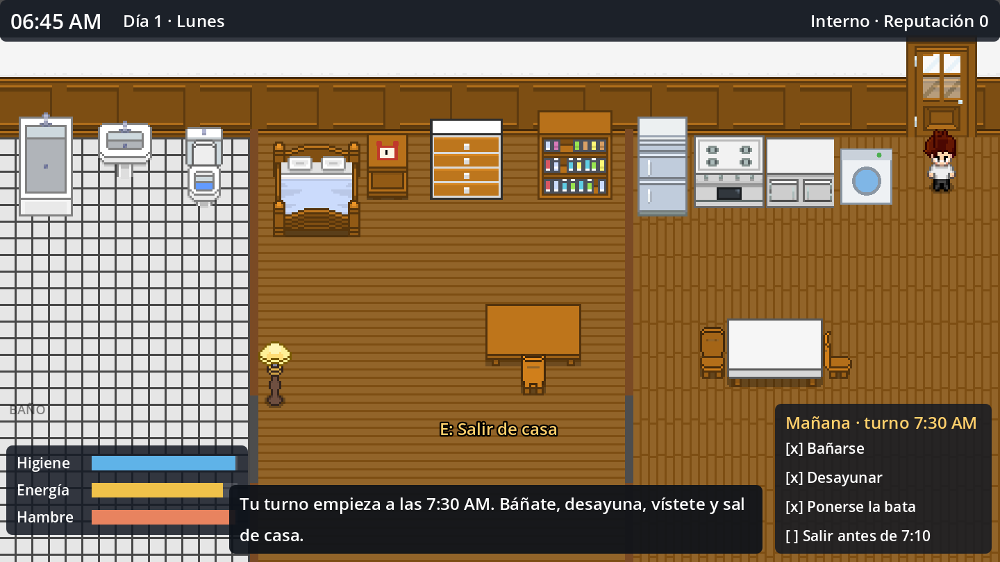
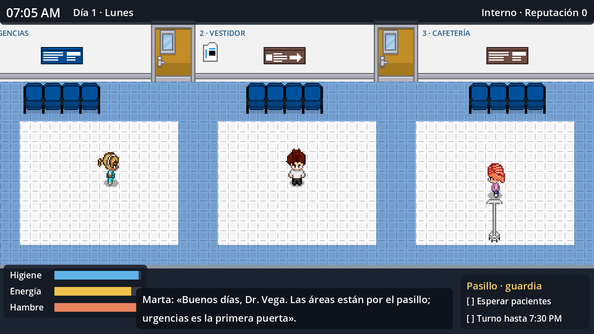

# Bata Blanca: Hospital de Pillbox

Juego 2D de vista cenital en **Godot 4.5** · Diseño Multimedia y Videojuegos · FESC.

El Dr. **Walter Vega** empieza como interno en el Hospital de Pillbox. Cada día se levanta en su casa, se prepara, trabaja su turno de 7:30 AM a 7:30 PM y vuelve a casa a descansar. Cómo cuide su rutina tiene consecuencias en el hospital.






## Cómo abrirlo

1. Instala **Godot 4.5** (versión estándar, no hace falta la de .NET).
2. En el Project Manager: **Importar** → selecciona `project.godot` de esta carpeta.
3. Pulsa **F5** (o el botón ▶) para jugar.

## Controles

| Tecla | Acción |
|---|---|
| WASD / flechas | Moverse |
| E o Espacio | Interactuar con lo que está cerca |
| 1-9 o clic | Elegir opción en los menús · Esc cancela |
| Tab (mantener) | Acelerar el tiempo ×10 (para probar) |

## Versión 1: qué incluye

**El día de Walter**
- Reloj del juego: 1 minuto real = 10 minutos de juego. Cada acción gasta tiempo (bañarse 15 min, desayuno 5 o 20 min, vestirse 10 min, viaje 20 min).
- **Mañana en casa:** bañarse, desayunar, ponerse la bata y salir. Checklist en pantalla.
- **Turno en el hospital** de 7:30 AM a 7:30 PM. Al terminar, vuelve solo a casa.
- **Noche en casa:** cenar, ponerse la pijama, poner la alarma y dormir. **Dormir guarda la partida.**

**Necesidades y consecuencias**
- **Higiene:** baja con el tiempo. Con higiene baja se ven olores verdes sobre Walter; si es muy baja, Lucía y los pacientes se quejan y baja la reputación.
- **Energía:** baja durante el día y se recupera durmiendo (menos sin pijama). Con poca energía Walter camina más lento.
- **Hambre:** sin desayunar o cenar baja rápido, y con hambre la energía cae el doble. En el hospital hay máquina de snacks.
- **Bata:** ir en pijama obliga a ir al vestidor del hospital (10 min, −3 reputación). Después de 3 turnos la bata se ensucia; se lava en la lavadora de la casa.
- **Alarma:** sin alarma, Walter se despierta entre 7:15 y 8:30. Llegar después de las 7:30 resta reputación; 5 días seguidos puntual suman.
- No ir al hospital antes del mediodía cuenta como falta (−15). Quedarse despierto hasta las 2:00 AM hace que Walter se duerma donde esté.

**Hospital** (varias salas conectadas)
- **Recepción** con Marta, sala de espera, sofás, plantas y máquina de snacks → **Pasillo** (sillas contra la pared, letreros y piso azul con paneles) con cinco puertas: **1 Urgencias**, **2 Vestidor** (casilleros con batas y ducha del personal), **3 Cafetería** (almuerzo y máquina de snacks), **4 Dirección** (el Dr. Salgado comenta tu reputación) y **5 Consultorios** (cerrado hasta ser Residente).
- Los pacientes siguen empeorando aunque Walter esté en otra sala; el altavoz lo llama a urgencias cuando llega alguien.
- Llegan 3-4 pacientes por día a horas distintas. Desde el día 2 puede llegar un caso grave.
- Ciclo: **examinar → elegir diagnóstico → tomar el insumo del botiquín → aplicarlo**. Un diagnóstico errado baja la estabilidad; si llega a 0, el paciente se transfiere (−5).
- Lucía, en la recepción, da pistas sobre qué insumo usar.

## Estructura

```
project.godot
escenas/   menu.tscn · casa.tscn · hospital.tscn
scripts/   juego.gd (autoload «Juego»: reloj, necesidades, guardado)
           sala.gd (base de casa y hospital) · casa.gd · hospital.gd
           walter.gd · personaje.gd (sprites MetroCity por capas) · hud.gd · interactuable.gd · fondo.gd · menu.gd
pruebas/   prueba.tscn + corredor.gd (juega un día y medio automáticamente)
arte/      assets MetroCity (JIK-A-4) · créditos en arte/CREDITOS.md
docs/      documentación del taller de narrativa
```

Las salas se construyen por código en `construir()` (muebles, zonas interactuables y colisiones), así que para mover un mueble basta con cambiar su posición en `casa.gd` o `hospital.gd`. En el hospital, cada sala vive en su propia zona del mundo (`SALAS` en `hospital.gd`) y las puertas mueven a Walter y a la cámara entre ellas. El campo `interior` de cada sala define el tamaño real del cuarto: el vestidor, la cafetería y la dirección son pequeños y quedan enmarcados en la pantalla.

**Personajes:** `personaje.gd` arma cada persona con capas de MetroCity (cuerpo con 6 tonos de piel + ropa + pelo), con caminata de 6 cuadros en 4 direcciones. Para crear un NPC basta con `npc(piel, ropa, hoja_pelo, fila_pelo, posición)`.

## Prueba automática

`pruebas/prueba.tscn` juega solo: la mañana, un paciente atendido y otro transferido, la noche, dormir con alarma, un día 2 tarde y sucio, y la carga de partida. Para correrla, abre la escena en Godot y pulsa **F6**; los resultados salen en la consola (`OK` / `FALLA`).

## Pendiente para la versión 2

- Estudiar en el escritorio, estrés, dinero y sueldo, eventos aleatorios, evaluación semanal de Salgado, capacitaciones y ascenso de rango.
- Sonido.
