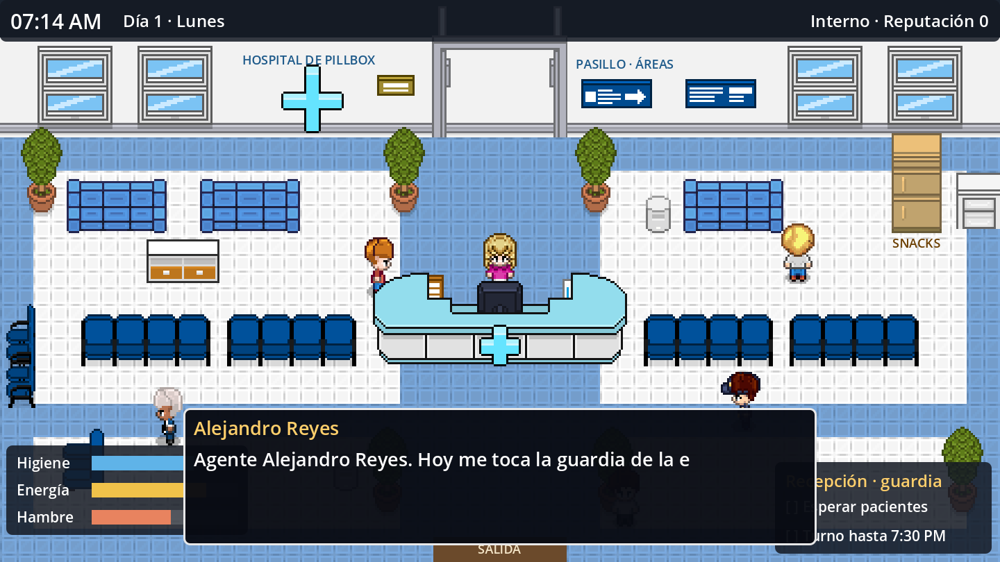

# Bata Blanca: Hospital de Pillbox

Juego 2D de vista cenital en **Godot 4.5** · Diseño Multimedia y Videojuegos · FESC.

El Dr. **Walter Pinkman** empieza como interno en el Hospital de Pillbox. Cada día se levanta en su casa, se prepara, trabaja su turno de 7:30 AM a 7:30 PM y vuelve a casa a descansar. Cómo cuide su rutina tiene consecuencias en el hospital.




## Cómo abrirlo

1. Instala **Godot 4.5** (versión estándar, no hace falta la de .NET).
2. En el Project Manager: **Importar** → selecciona `project.godot` de esta carpeta.
3. Pulsa **F5** (o el botón ▶) para jugar.

## Controles

| Tecla | Acción |
|---|---|
| WASD / flechas | Moverse |
| E o Espacio | Interactuar con lo que está cerca |
| 1-9 o clic | Elegir opción en los menús · Esc cancela |
| C | Abrir el celular (mensajes, tienda, banco) |
| Tab (mantener) | Acelerar el tiempo ×10 (para probar) |

## Versión 1: qué incluye

**El día de Walter**
- Reloj del juego: **1 segundo real = 1 minuto de juego** (un turno de 12 horas dura unos 12 minutos reales). Cada acción gasta tiempo (bañarse 15 min, desayuno 5 o 20 min, vestirse 10 min, viaje 20 min).
- **Mañana en casa:** bañarse, desayunar, ponerse la bata y salir. Checklist en pantalla.
- **Turno en el hospital** de 7:30 AM a 7:30 PM. Al terminar, vuelve solo a casa.
- **Noche en casa:** cenar, ponerse la pijama, poner la alarma y dormir. **Dormir guarda la partida.**

**Necesidades y consecuencias**
- **Higiene:** baja con el tiempo. Con higiene baja se ven olores verdes sobre Walter; si es muy baja, Lucía y los pacientes se quejan y baja la reputación.
- **Energía:** baja durante el día y se recupera durmiendo (menos sin pijama). Con poca energía Walter camina más lento.
- **Hambre:** sin desayunar o cenar baja rápido, y con hambre la energía cae el doble. En el hospital hay máquina de snacks.
- **Bata:** ir en pijama obliga a ir al vestidor del hospital (10 min, −3 reputación). Después de 3 turnos la bata se ensucia; se lava en la lavadora de la casa.
- **Alarma:** sin alarma, Walter se despierta entre 7:15 y 8:30. Llegar después de las 7:30 resta reputación; 5 días seguidos puntual suman.
- No ir al hospital antes del mediodía cuenta como falta (−15). Quedarse despierto hasta las 2:00 AM hace que Walter se duerma donde esté.

**Hospital** (varias salas conectadas)
- **Recepción** con Erina, sala de espera, sofás, plantas y máquina de snacks → **Pasillo** (sillas contra la pared, letreros y piso azul con paneles) con cinco puertas: **1 Urgencias**, **2 Vestidor** (casilleros con batas y ducha del personal), **3 Cafetería** (almuerzo y máquina de snacks), **4 Dirección** (el Dr. Salgado comenta tu reputación) y **5 Consultorios** (cerrado hasta ser Residente).
- Los pacientes siguen empeorando aunque Walter esté en otra sala; el altavoz lo llama a urgencias cuando llega alguien.
- Llega un paciente cada 40-70 minutos de juego (unos 12 por turno). Puede llegar un caso grave, más seguido desde el día 2.
- Ciclo: **el paciente cuenta qué le pasó → examinar con una herramienta (termómetro, estetoscopio, tensiómetro, otoscopio, linterna, glucómetro o palpar) → elegir diagnóstico → tomar el insumo del botiquín → aplicarlo**. Hay 19 casos base (de herida y fiebre a migraña, gastritis, faringitis, picadura de abeja, golpe en la cabeza, alergia grave, golpe de calor o infarto) más 6 de especialidad; en los graves el paciente no puede hablar y lo cuenta Lucía. Cada paciente da +3 de reputación (graves +6); con un error, solo +1.
- Si Walter no está seguro, puede **derivar** al paciente. Con 4 derivados en la semana, Salgado llama a Walter y a Noctis a la dirección. Lucía o el Dr. Brown orientan cuando Walter se equivoca, y Brown puede dar una pista (3 al día) o atender a un paciente (cuenta como derivado). Un diagnóstico errado baja la estabilidad; si llega a 0, el paciente se transfiere (−5).
- Lucía, en la enfermería de urgencias, da pistas sobre qué insumo usar.

**Eventos**
- **Hora pico:** un accidente trae varios pacientes seguidos.
- **Apagón:** el hospital se oscurece y los pacientes empeoran más rápido. Hay que avisar a Salgado para que llame al electricista **Paul Catelli**; tus consejos deciden si la luz vuelve a fallar y qué tan seguido se va.
- **El director llama por el megáfono** cada pocos días para hablar del rendimiento.
- **Cafetería:** bebida energética (1 por turno: +15 % de energía y más velocidad por 1 minuto) y Doña Luz en la barra.

**Personas, diálogos y sonido**
- 20 NPC con nombre propio y diálogos (E para hablar). Todos caminan por su zona, menos las enfermeras de mostrador (Erina en recepción y Lucía en urgencias).
- Policías: **Alejandro Reyes** (entrada), **Jaiden Mendoza** (urgencias) y **John McClane** (pasillo). Médicos: **Dr. Maximiliano Brown** (urgencias), **Dr. Máximo Stone** y **Dr. Enzo Escobar** (pasillo), **Dr. Zacarías Flores** (vestidor, nervioso porque le gusta la oficial Dakota del LSPD) y Dr. Ramírez, **Dr. Wilder Noctis** (cafetería, el más perezoso) y el Dr. Salgado (dirección). También: Paola, el enfermero **Diego Quiroz** (siempre riéndose de los chistes de la señorita Sheyla), el camillero **Cristian Daniel**, Sofía, Doña Gloria, Don Ernesto, Samuel y Don Pedro.
- Los textos se escriben letra por letra con un sonidito de voz retro distinto para cada personaje; E salta o avanza.
- Música tranquila en el hospital y otra, más hogareña, en la casa. Efectos: altavoz, puertas, alarma, acierto y error.

**Relaciones y diálogos con respuesta**
- Muchas conversaciones terminan con respuestas para elegir. Cada NPC tiene un medidor de amistad (corazones junto a su nombre) que se guarda.
- Con amistad: Lucía vigila a un paciente para que no empeore, Erina avisa qué trae el próximo paciente y Cristian Daniel trae un insumo. Cubrir a Wilder deja un favor que se cobra pidiéndole que atienda a un paciente.
- A los pacientes se les puede calmar (empeoran más lento).
- Historias por días: **Zacarías y la oficial Dakota** (consejos, el café, el regalo para la cita… y quizá terminen de novios), **Wilder y Salgado** (encubrirlo o delatarlo; con una segunda oportunidad termina trabajando en urgencias y estudiando para ser Residente) y **Rhea Pawlak y Alejandro Reyes** (Rhea se cae de la moto y llega como paciente; Reyes te pide consejo desde el día 3, ella pregunta por él el día 5 y, si la animas, desde el día 7 viene a «reforzar la guardia» con él). Diego Quiroz molesta al interno Jinu Blake con lo de la señorita Sheyla.

**Carrera: estudiar y ascender**
- Escritorio de la casa: estudiar 30 min o 1 h, con una pregunta de repaso (acertar suma media hora).
- Tablón de capacitaciones en el pasillo: con reputación 80, 5 h de estudio y 3 turnos, Walter elige especialidad (Urgencias, Pediatría o Cirugía) y pasa a **Residente**. Se abre su consultorio y llegan casos e insumos de su especialidad.

**Sala de espera y triaje**
- Los pacientes entran caminando a urgencias y esperan frente a las sillas. Lucía los marca en rojo, amarillo o verde y Walter decide a quién pasa a cada camilla.

**Dinero, celular y fin de semana**
- Sueldo por turno ($60 Interno, $110 Residente) que se paga el viernes, junto con la **evaluación semanal** de Salgado (nota y bono de reputación). Arriendo de $150 cada lunes.
- La nevera se gasta al comer; se compra mercado o domicilio desde el celular. Mejoras: cafetera y cama nueva.
- Celular (tecla C): mensajes de mamá, Lucía, Wilder, Diego y otros (algunos con respuesta), tienda y banco.
- Sábado y domingo no hay turno: mercado, parque o visitar a mamá.

## Estructura

```
project.godot
escenas/   menu.tscn · casa.tscn · hospital.tscn
scripts/   juego.gd (autoload «Juego»: reloj, necesidades, dinero, amistad, guardado)
           casos.gd (casos clínicos, herramientas e insumos)
           sala.gd (base de casa y hospital) · casa.gd · hospital.gd
           walter.gd · npc.gd (NPC que caminan y hablan) · personaje.gd (sprites MetroCity por capas) · hud.gd · interactuable.gd · fondo.gd · menu.gd
pruebas/   prueba.tscn + corredor.gd (juega un día y medio automáticamente)
arte/      assets MetroCity (JIK-A-4) · créditos en arte/CREDITOS.md
audio/     música y efectos (WAV) generados por herramientas/generar_audio.py
herramientas/  generar_audio.py: sintetiza toda la música y efectos (chiptune original)
docs/      documentación del taller de narrativa
```

Las salas se construyen por código en `construir()` (muebles, zonas interactuables y colisiones), así que para mover un mueble basta con cambiar su posición en `casa.gd` o `hospital.gd`. En el hospital, cada sala vive en su propia zona del mundo (`SALAS` en `hospital.gd`) y las puertas mueven a Walter y a la cámara entre ellas. El campo `interior` de cada sala define el tamaño real del cuarto: el vestidor, la cafetería y la dirección son pequeños y quedan enmarcados en la pantalla.

**Personajes:** `personaje.gd` arma cada persona con capas de MetroCity (cuerpo con 6 tonos de piel + ropa + pelo), con caminata de 6 cuadros en 4 direcciones. Para crear un NPC basta con `npc(piel, ropa, hoja_pelo, fila_pelo, posición)`.

## Prueba automática

`pruebas/prueba.tscn` juega solo: la mañana, un paciente atendido y otro transferido, la noche, dormir con alarma, un día 2 tarde y sucio, y la carga de partida. Para correrla, abre la escena en Godot y pulsa **F6**; los resultados salen en la consola (`OK` / `FALLA`).

## Pendiente para la versión 2

- Estrés, eventos aleatorios, horas extra y capacitaciones siguientes (Especialista → Jefe de servicio → Director).
